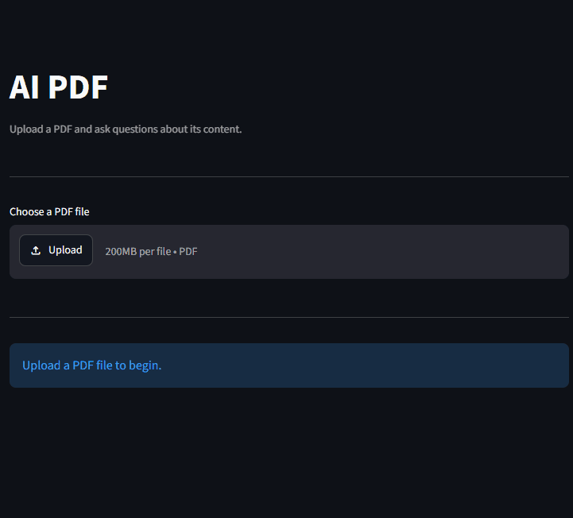

# AI PDF

## Live Demo

**[Try the AI Poet Application](https://ai-pdf-kc7kpfy4wzkebruhzywafr.streamlit.app/)**

An AI-powered PDF Question Answering application built with Streamlit, LangChain, OpenAI, and ChromaDB.

Users can upload a PDF document and ask natural language questions about its contents. The application retrieves the most relevant sections from the PDF using a Retrieval-Augmented Generation (RAG) pipeline before generating an answer with OpenAI.

---

## Features

- Upload PDF documents
- Automatic text extraction from PDFs
- Document chunking with LangChain
- OpenAI Embeddings
- Chroma vector database
- RAG (Retrieval-Augmented Generation)
- Natural language question answering
- Source page references
- Error handling

---

## Tech Stack

- Python
- Streamlit
- LangChain
- OpenAI API
- ChromaDB
- PyPDF
- RecursiveCharacterTextSplitter

---

## AI Pipeline

PDF Upload

↓

PyPDFLoader

↓

Text Splitter

↓

OpenAI Embeddings

↓

Chroma Vector Database

↓

Retriever (MMR)

↓

GPT-4.1 Mini

↓

Answer + Source Pages

---

## Project Structure

```
AI-PDF/
├── main.py
├── requirements.txt
├── images
|   └──ai-pdf.gif
├── .env.example
├── .gitignore
└── README.md
```

## Installation

```bash
git clone https://github.com/SooooCoding/ai-pdf.git
cd ai-pdf

pip install -r requirements.txt
```

Create a `.env` file.

```env
OPENAI_API_KEY=your_api_key
```

Run the application.

```bash
python -m streamlit run main.py
```

## Preview



---

## Example

1. Upload a PDF.
2. Ask a question about the document.
3. Receive an AI-generated answer.
4. View the source pages used to generate the answer.

## Planned Improvements

- Multiple PDF support
- Chat history
- Streaming responses
- Persistent Chroma database
- PDF citation highlighting